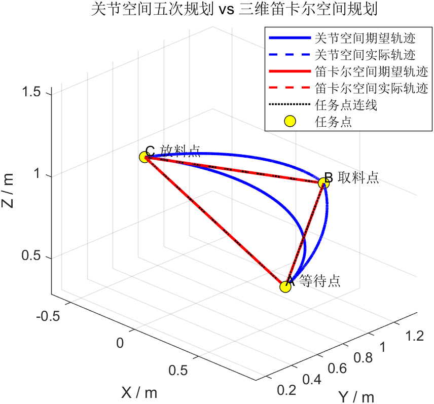

# Robot Arm Trajectory Planning and Control

A simulation coursework archive progressing from a planar 2-DOF arm to a spatial 3-DOF yaw-pitch-pitch arm. MATLAB compares cubic, quintic, trapezoidal-velocity and Cartesian straight-line trajectories under fixed PID gains. The 3-DOF PyBullet implementation adds a URDF multibody model, gravity, computed-torque control and geometry alignment checks.

[中文详细说明](docs/README.zh-CN.md) · [Architecture](docs/ARCHITECTURE.md) · [Run guide](docs/RUNNING.md) · [Results and evidence](docs/RESULTS.md) · [Validation](docs/VALIDATION.md) · [Provenance](docs/PROVENANCE.md)



## Scope

- `planar_2dof/`: two-link planar kinematics, modular planning and PID comparison; the optional `main_baseline.m` retains the earlier monolithic baseline.
- `spatial_3dof/`: spatial position planning, MATLAB simulation, CSV export, URDF and gravity-enabled PyBullet torque tracking.
- `results/spatial_3dof/`: six original MATLAB PNG plots, one existing PyBullet model screenshot and an existing gravity-path comparison figure.
- Three existing CSV files are included beside the programs that read them. `SOURCE_MANIFEST.csv` records unchanged source copies and their SHA-256 hashes.

This project controls end-effector **position**, not a full six-dimensional pose. A/B/C are illustrative transfer waypoints. There is no gripper, object contact, grasping experiment or physical robot validation.

## The two dynamics models

| Component | Actual implementation | What the evidence means |
|---|---|---|
| MATLAB, both arms | Independent joints: `J*qdd + B*qd = u`; PID outputs torque; discrete integration | A controlled comparison on a simplified plant; no gravity, Coriolis terms or joint coupling |
| 2-DOF PyBullet | Reads MATLAB actual joint angles and uses `resetJointState` at each displayed sample | A kinematic playback, even though gravity is enabled |
| 3-DOF PyBullet | URDF rigid bodies; `g = -9.81 m/s²`; inverse dynamics and `TORQUE_CONTROL` | A separate simulated dynamics experiment with different PID gains and physical parameters |

The PyBullet controller uses `qdd_cmd = qdd_d + Kp*(q_d-q) + Kd*(qd_d-qd) + Ki*integral(q_d-q)`, then computes `tau = inverseDynamics(q, qd, qdd_cmd)` and clips the command. MATLAB and PyBullet tracking errors and torque magnitudes are not interchangeable benchmarks.

## Existing 3-DOF MATLAB results

Values below come from the revised course report; the archive validation describes which values were checked again.

| Method | End-effector RMSE (mm) | Maximum error (mm) | Maximum torque (N·m) | Maximum planned speed (deg/s) |
|---|---:|---:|---:|---:|
| Cubic | 1.834 | 3.640 | 0.115 | 53.59 |
| Quintic | 2.026 | 4.604 | 0.148 | 66.99 |
| Trapezoidal velocity | 1.834 | 4.244 | 0.133 | 47.64 |
| Cartesian + quintic timing | 1.853 | 4.476 | 0.239 | 97.15 |

Quintic interpolation provides zero endpoint velocity and acceleration for each joint-space segment. It does **not** achieve the smallest tracking error with the current shared PID gains. The velocity plot compares planned trajectories; it is not a desired-versus-actual velocity plot.

## Quick start

Run each MATLAB project from its own folder to avoid function-name collisions. MATLAB R2022a is available in the archive-preparation environment. The scripts use base MATLAB numerical, table and plotting facilities; full animation generation also needs a working graphics/video setup.

```matlab
cd planar_2dof
run_advanced_checks
% Optional: main_advanced  % plots and four animation videos
```

In a fresh MATLAB session, or after returning to the repository root:

```matlab
cd spatial_3dof
run_3dof_checks
% Optional: main_advanced_3dof  % plots, CSV exports and four videos
```

Python dependencies are listed in `requirements.txt`; this is a dependency list, not a frozen historical environment.

```powershell
python -m pip install -r requirements.txt
python spatial_3dof/run_cartesian_pybullet_checks.py
python spatial_3dof/run_gravity_pybullet_checks.py
```

For optional full gravity simulation and video generation, see the [run guide](docs/RUNNING.md). Those runs were not repeated while preparing this archive.

## Attribution and limits

The repository owner confirmed independent development of the kinematics, planning and control simulation presented here. Course submission materials also list group roles for presentation and reporting; those materials are not a basis for claiming authorship of other members' writing or presentation. Standard interpolation, geometric kinematics and PID methods are established techniques; this archive does not claim their invention. See [provenance](docs/PROVENANCE.md) and [third-party notices](THIRD_PARTY_NOTICES.md).

Source headers are preserved. No repository-wide reuse license has been assigned in this archive. The public selection excludes reports/slides containing personal information, duplicate source snapshots, local environments/caches and repeated videos. Original reports and source projects remain separate from this publication selection.
