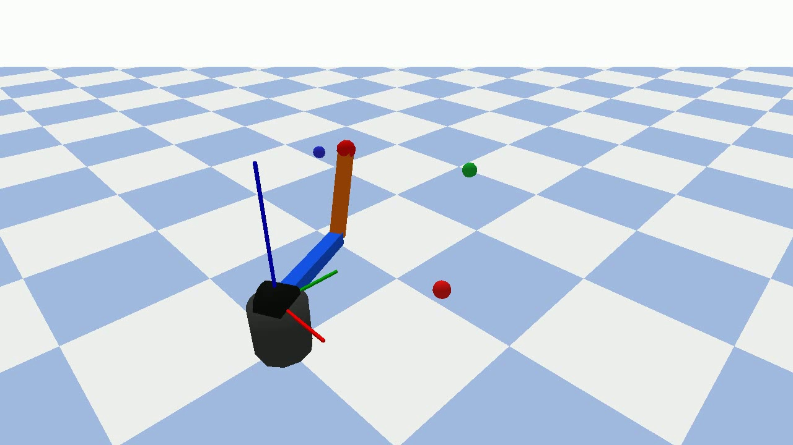

# Results and evidence index

## Existing MATLAB evidence

The following values were transcribed from the revised course report (technical tables only; the original report contains personal identifiers and is excluded).

| Method | EE RMSE (mm) | EE max (mm) | Max torque (N·m) | Planned speed max (deg/s) | Planned acceleration max (deg/s²) |
|---|---:|---:|---:|---:|---:|
| Cubic | 1.834 | 3.640 | 0.115 | 53.59 | 71.45 |
| Quintic | 2.026 | 4.604 | 0.148 | 66.99 | 68.76 |
| Trapezoid | 1.834 | 4.244 | 0.133 | 47.64 | 63.51 |
| Cartesian | 1.853 | 4.476 | 0.239 | 97.15 | 130.42 |

These are one configured 3-DOF simulation, not a universal ordering. Quintic improves endpoint acceleration continuity, while cubic and trapezoid have slightly lower RMSE with these gains. Cartesian planning preserves the requested straight-line geometry but has higher peak joint demand in this scenario.

| Archived image | Interpretation |
|---|---|
| [01 joint angles](../results/spatial_3dof/01_joint_angle_comparison.png) | Planned cubic, quintic and trapezoidal joint positions |
| [02 joint velocities](../results/spatial_3dof/02_joint_velocity_comparison.png) | Planned velocities only; no actual-velocity comparison |
| [03 joint accelerations](../results/spatial_3dof/03_joint_acceleration_comparison.png) | Endpoint constraints and acceleration discontinuities |
| [04 tracking error](../results/spatial_3dof/04_pid_tracking_error_comparison.png) | Simplified MATLAB plant position error |
| [05 control torque](../results/spatial_3dof/05_pid_control_torque_comparison.png) | MATLAB PID torque on the simplified plant |
| [06 end-effector paths](../results/spatial_3dof/06_end_effector_3d_path_comparison.png) | Curved joint-space versus near-straight Cartesian segments |

## Existing PyBullet evidence

The revised report records the following rounded values from the existing 3-DOF gravity-enabled simulations:

| Trajectory | Max joint error (deg) | Max EE error (mm) | Max commanded torque (N·m) | Sampled FK alignment max (m) |
|---|---:|---:|---:|---:|
| Joint-space quintic | 0.088 | about 0.7 | 15.241 | 8.385e-8 |
| Cartesian | 0.135 | about 1.0 | 15.182 | 8.105e-8 |

These are **historical report values**, not fresh archive-preparation simulation results. No per-step PyBullet actual-state log is bundled, so these maxima cannot be independently recalculated from the MATLAB CSV files alone. Printed end-effector errors were rounded to four decimal places in metres; avoid treating 0.7/1.0 mm as strict exact bounds. See [measurement details](ARCHITECTURE.md).

[Existing desired/actual gravity trajectory comparison](../results/spatial_3dof/pybullet_gravity_trajectory_comparison.png) was generated during report revision using the then-current controller; the figure-generation snippet was not saved as an independent source file. The archived tracking implementation remains the rerun entry. The historical two videos were 511 frames each at 1280×720/30 FPS; they are excluded to avoid publishing repetitive video artifacts.

## Evidence boundaries

- CSV files preserve original MATLAB outputs; they include both desired and simplified-plant actual states.
- PNGs and the screenshot are existing simulation artifacts, copied without image editing.
- Current archive checks, exact environments, result comparisons and skipped runs are recorded separately in [VALIDATION.md](VALIDATION.md).
- No physical arm, actuator identification, payload experiment, obstacle-avoidance validation or grasp/release test is evidenced here.
